# Tony Ford's Free Image Gallery

**A free, self-hosted image gallery in PHP + MySQL/MariaDB.** Share your pictures as the only poster (**Single owner**) or let everybody sign up and share (**Open registration**) - you choose in the installer and can change it any time in *Admin → Settings*.

by **Anthony W. Ford, Jr. (Tony Ford)** - awfordjr@gmail.com · Free for **non-commercial** use (see [License](#license)).

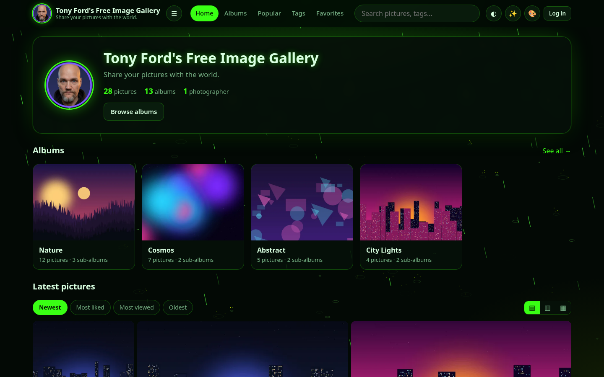

## Features
- Nested albums (sub-albums to any depth) with breadcrumbs
- Justified / masonry / square grid, lazy loading, pagination, search, tags, popular
- Lightbox with keyboard + swipe, slideshow, fullscreen
- Drag & drop multi-upload with progress, EXIF display, WebP thumbnails, album covers
- Likes / favorites, comments, SEO-friendly URLs, sitemap.xml
- Admin dashboard with stats, moderation queue, bulk image actions, user management, settings
- **10 themes** with animated effects (reduced-motion aware, pause when the tab is hidden, on/off toggle), selectable by admin and per visitor
- Light/dark toggle, responsive layout
- Tony's branding: selfie avatar/logo + favicon, footer credit

## Install (5 steps)
Requirements: PHP 8.0+ (8.2+ recommended) with `pdo_mysql`, `gd`, `fileinfo` (`exif` and GD WebP optional), MySQL 5.7+/MariaDB 10.3+, Apache (or nginx).

1. Upload the folder contents to your web space.
2. Make the site folder and `uploads/` writable by PHP.
3. Open `https://your-site/install.php`.
4. Pick **Single owner** or **Open registration**, enter the database details, site title and admin account.
5. Install. It creates the tables + admin, writes `config.php`, then **locks itself** (`install.php` → `install.php.locked`).

If `config.php` can't be written, the installer shows its contents so you can save it by hand.

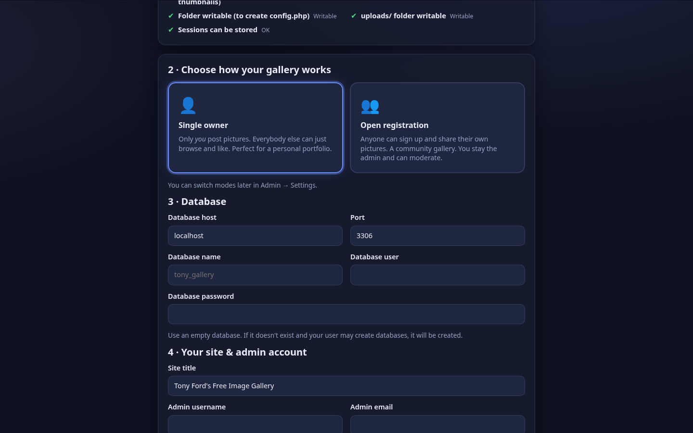

Optional demo content (nested albums + 28 generated pictures, no copyrighted photos): `php tools/seed-demo.php`

### nginx
```nginx
location / { try_files $uri $uri/ /index.php?r=$uri&$args; }
location ~ ^/(inc|pages|tools)/ { deny all; }
location ~ ^/(config\.php|install\.php\.locked)$ { deny all; }
location ^~ /uploads/ { location ~ \.php$ { deny all; } }
location ~ \.php$ { fastcgi_pass unix:/run/php/php-fpm.sock; include fastcgi_params;
                    fastcgi_param SCRIPT_FILENAME $document_root$fastcgi_script_name; }
```
(nginx rules are provided as a guide; the automated tests ran on PHP's built-in server + MariaDB. Apache `.htaccess` files are included.)

## Themes
Toxic Rain · Matrix · Dragon's Lair · Midnight Starfield · Ember Glow · Frozen Snowfall · Neon Synthwave · Ocean Depths · Classic Light · Classic Dark

| | | |
|---|---|---|
|  | 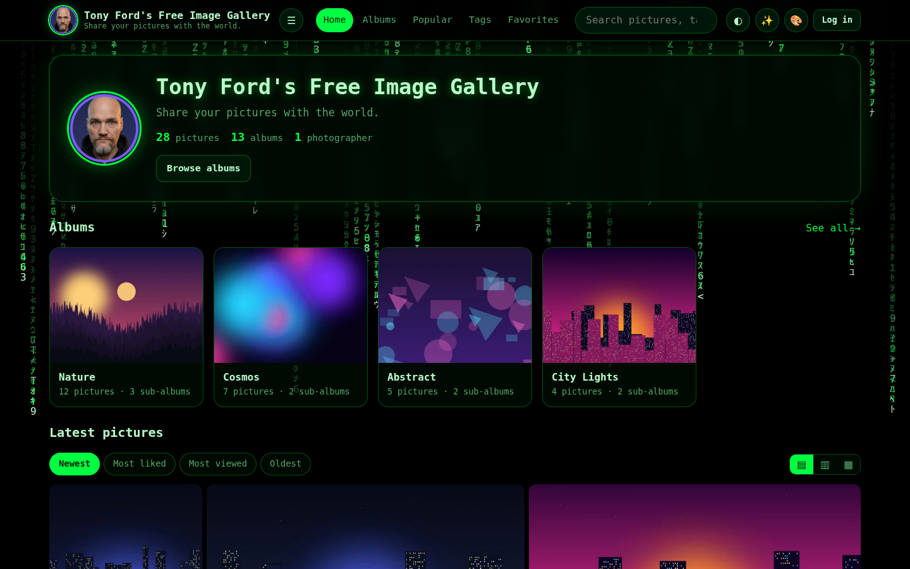 | 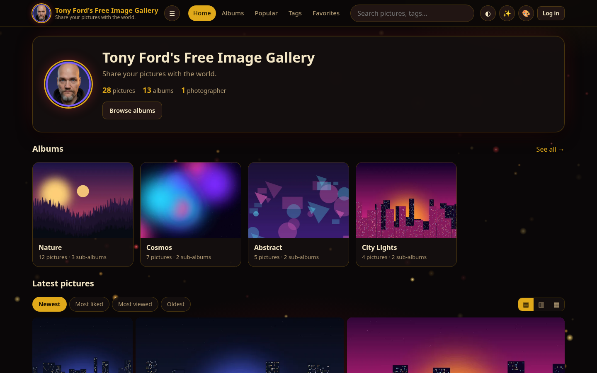 |
| 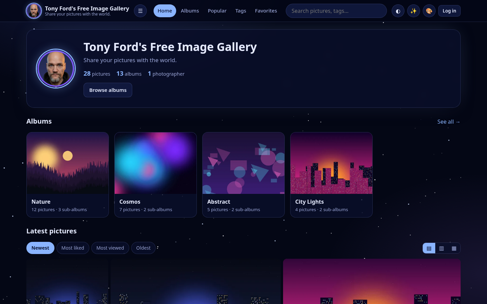 | 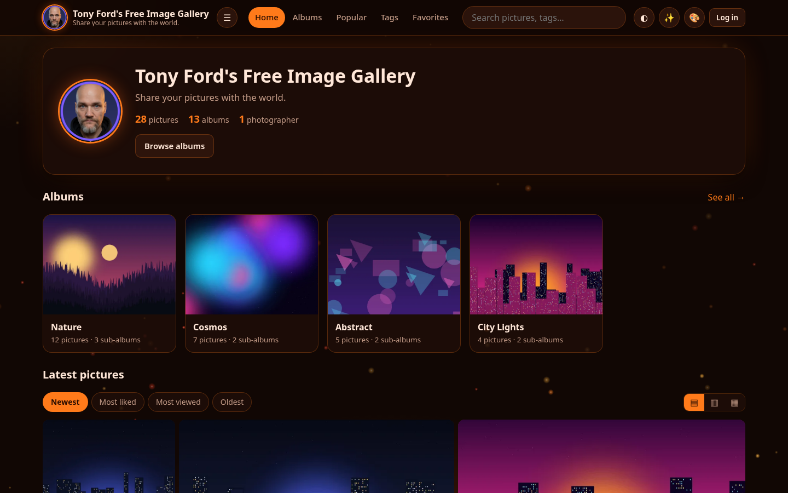 | 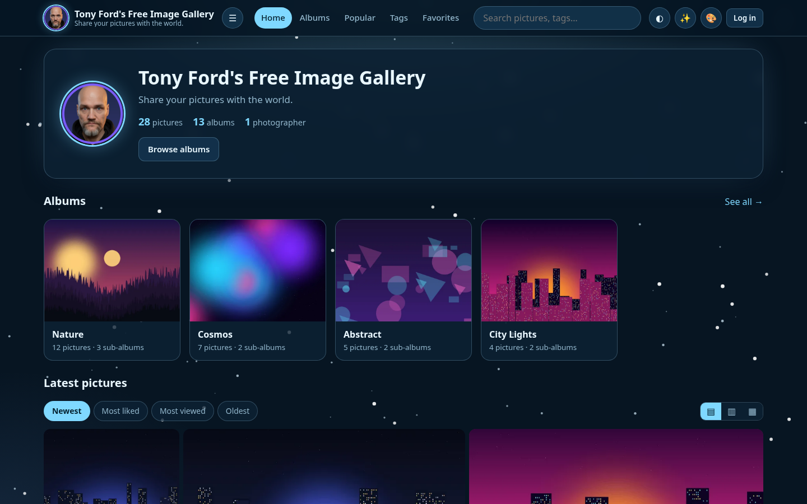 |
| 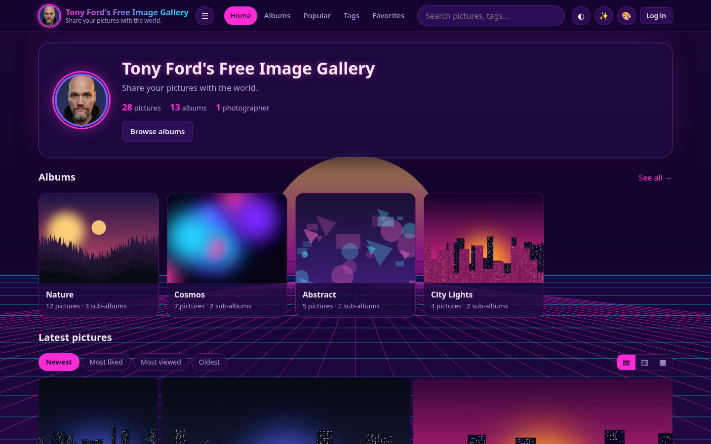 | 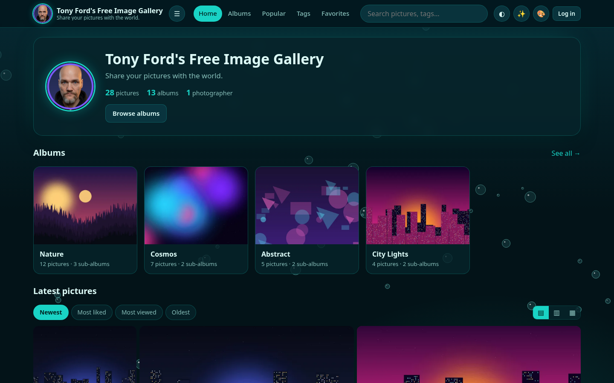 | 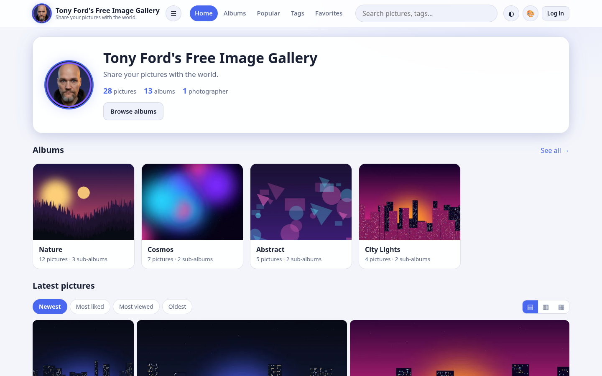 |
| 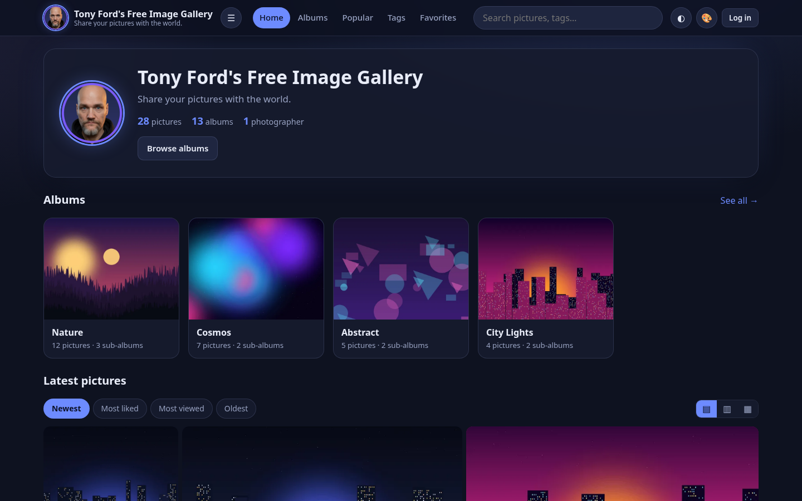 | 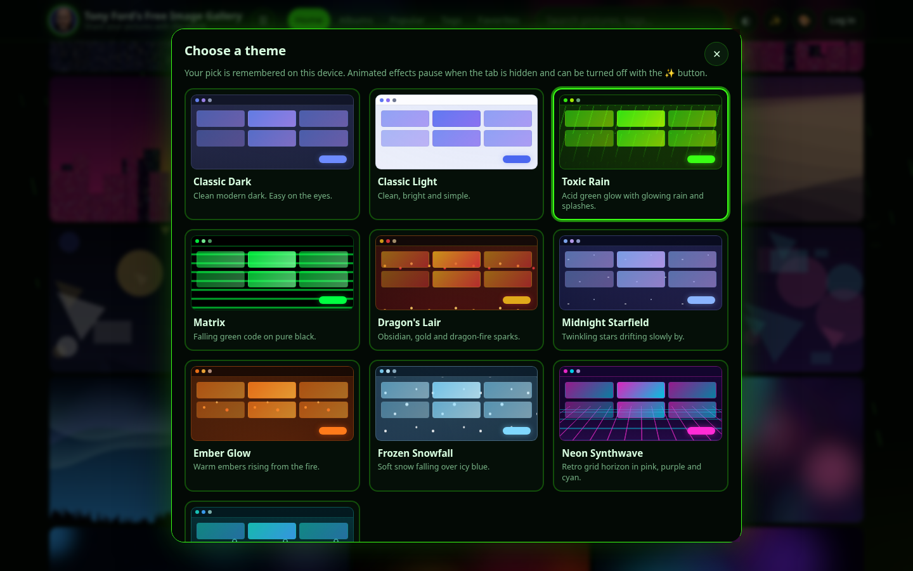 | 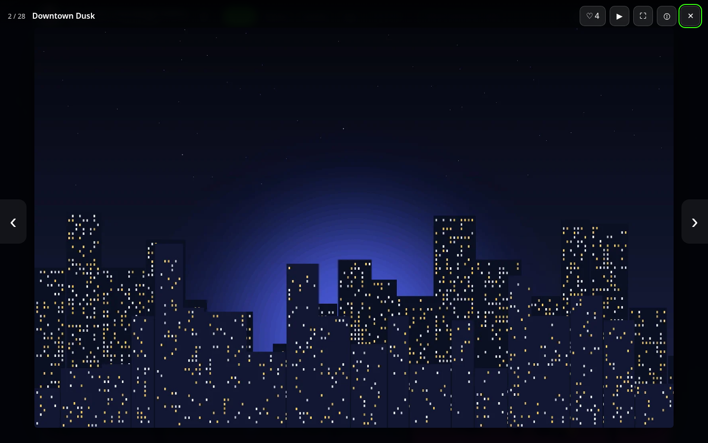 |

More: [upload page](screenshots/upload.png) · [admin dashboard](screenshots/admin-dashboard.png) · [admin themes](screenshots/admin-themes.png)

## Security
PDO prepared statements everywhere · `password_hash` · CSRF tokens on every POST · session id regenerated on login, HttpOnly + SameSite cookies · login throttling · strict CSP (no inline JS) · uploads: real MIME check (finfo), size + pixel limits, GD re-encode, random file names, GIFs with embedded code rejected, `uploads/.htaccess` blocks script execution · `inc/`, `pages/`, `tools/`, `config.php` not web-accessible.

## Layout
`index.php` front controller · `install.php` installer stub (`inc/installer.php`) · `inc/` core · `pages/` views + admin + api · `assets/` css/js/img · `uploads/` (created files) · `tools/seed-demo.php` · `router.php` (only for `php -S`)

Quick local try: `php -S 127.0.0.1:8080 router.php` then open `/install.php`.

## License
Free for **non-commercial** use only. No selling, no profit, **no modifications**, no taking credit - keep the footer credit and credit **Tony Ford (awfordjr@gmail.com)**. Full text: [LICENSE.txt](LICENSE.txt).

---
Tony Ford's Free Image Gallery by Anthony W. Ford, Jr. (Tony Ford) - awfordjr@gmail.com
